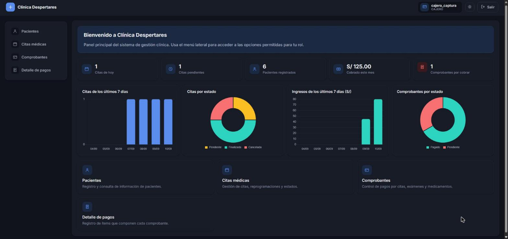
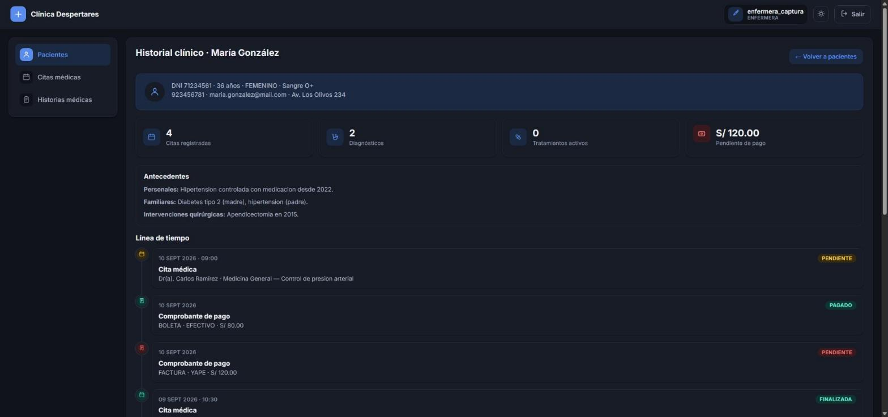

# Clínica Despertares

[](https://github.com/luis1078/clinica-despertares-IS3/actions/workflows/ci.yml)


Sistema de gestión clínica (Spring Boot 3.5 + Thymeleaf + PostgreSQL): historias
clínicas, citas, diagnósticos, tratamientos, exámenes de laboratorio e
imágenes, comprobantes de pago, inventario de medicamentos y control de
acceso por rol para seis perfiles de personal distintos.

## Funcionalidades

- **Historial clínico unificado**: línea de tiempo por paciente que combina
  citas, diagnósticos, exámenes, tratamientos y pagos en un solo lugar
  (`Service/HistorialClinicoServiceImpl`).
- **Panel principal con gráficos** (Chart.js): indicadores y gráficos propios
  para cada rol — citas por día/estado para el personal clínico, ingresos y
  comprobantes para caja, diagnósticos por gravedad para el médico, stock de
  medicamentos para farmacia.
- **Control de acceso por rol**: `CAJERO`, `MEDICO`, `ENFERMERA`,
  `FARMACEUTICO`, `BIOLOGO`, `RADIOLOGO`, cada uno con su propio subconjunto
  de menú y permisos (`Config/AuthInterceptor.java`).
- CRUD completo de los 15 módulos del dominio, todos con búsqueda y paginación.
- Modo oscuro con detección automática del sistema + toggle manual persistido.
- Contraseñas con hash, protección CSRF en toda escritura, y borrados por POST.
- Datos de ejemplo al arrancar con la base vacía (`Config/DataSeeder.java`).
- Suite de tests (JUnit 5 + Mockito) corriendo en CI en cada push.

## Capturas





*(Si no las ves: ver [docs/screenshots/README.md](docs/screenshots/README.md) para generarlas.)*

## Opción A — Todo con Docker (recomendado)

Solo necesitas **Docker Desktop**. No hace falta JDK, Maven ni Postgres instalados en tu máquina.

```powershell
docker compose up -d --build
```

Esto construye la imagen de la app (multi-stage: compila con Maven Wrapper dentro del contenedor y deja solo el JAR + JRE 21 en la imagen final) y levanta dos contenedores:

- `isw2-postgres`: PostgreSQL 16 en el puerto `5432`.
- `isw2-app`: la aplicación en el puerto `8080`, que espera a que la base de datos esté healthy antes de arrancar.

Hibernate crea el esquema solo (`spring.jpa.hibernate.ddl-auto=update`) — no hay scripts SQL que correr a mano. La app queda en **http://localhost:8080** — la primera pantalla es `/login`, desde ahí puedes registrar una cuenta nueva.

Los datos de Postgres quedan en un volumen con nombre (`isw2_postgres_data`), así que sobreviven a `docker compose down` (solo se pierden si además borras el volumen con `-v`).

```powershell
docker compose logs -f app   # ver logs de la app
docker compose down          # parar todo
docker compose up -d --build # reconstruir tras cambiar código
```

## Opción B — Base de datos en Docker, app en local (para desarrollar)

Útil si vas a modificar código seguido: con `mvnw spring-boot:run` los cambios se recompilan más rápido que reconstruyendo la imagen cada vez.

### Requisitos

- **JDK 21** (no funciona con JDK 25+: Lombok no genera getters/setters y falla la compilación en silencio).
  Si no tienes uno, instala [Temurin 21](https://adoptium.net/temurin/releases/?version=21) y define `JAVA_HOME` apuntando ahí.
- **Docker Desktop** (solo para la base de datos).

No hace falta instalar Maven: el proyecto trae `mvnw` / `mvnw.cmd` (Maven Wrapper), que descarga Maven solo la primera vez que lo usas.

### 1. Levantar la base de datos

```powershell
docker compose up -d db
```

Usa los mismos usuario/clave/BD que ya trae `application.properties` por defecto (`postgres` / `password` / `postgres`) — no hace falta tocar nada más.

### 2. Levantar la aplicación

```powershell
$env:JAVA_HOME = "C:\ruta\a\tu\jdk-21"
$env:Path = "$env:JAVA_HOME\bin;" + $env:Path

.\mvnw.cmd spring-boot:run
```

La app queda en **http://localhost:8080**.

### Otros comandos útiles

```powershell
.\mvnw.cmd clean compile     # solo compilar
.\mvnw.cmd test              # correr los tests (los de Service.ServiceImpl no requieren BD; ClinicaDespertaresApplicationTests sí, porque levanta el contexto completo de Spring)
.\mvnw.cmd clean package      # generar el .jar en target/
```

## Configuración por variables de entorno (para otros entornos, no local)

`application.properties` lee estas variables si están definidas, y si no, usa los valores de desarrollo local:

| Variable | Default local |
|---|---|
| `DB_URL` | `jdbc:postgresql://localhost:5432/postgres?stringtype=unspecified` |
| `DB_USERNAME` | `postgres` |
| `DB_PASSWORD` | `password` |

## Roles, permisos y flujos

No se usa Spring Security: la autenticación es por sesión HTTP y los permisos se aplican en tres capas.

| Capa | Dónde | Qué hace |
|---|---|---|
| Interceptor global | `Config/AuthInterceptor.java` | Sin sesión → `/login`. Exige token CSRF en todo POST/PUT/DELETE/PATCH. Autoriza por **prefijo de URL** y rol; si no, → `/acceso-denegado`. |
| Comprobación en controlador | `Util/RolHelper.tieneRol(...)` | Solo en `MedicamentoController`, `ComprobantePagoController` y `DetalleComprobanteController` (`HistoriaMedicaController` tiene su propia versión). |
| Plantillas | `fragments/sidebar.html`, `index.html`, `*/listar.html` | Ocultan menús, botones y columnas de "Acciones" según `session.rolUsuario`. |

- **Login** con username o correo; solo entran usuarios con `estado = true`. Contraseñas con hash (`PasswordEncoder`).
- **Rutas públicas:** `/`, `/login`, `/registro`, `/acceso-denegado`, `/error` y estáticos.
- **Registro público** (`/registro`): se elige el rol; si es `MEDICO`, hay que asociar un médico existente.

### Roles

`CAJERO`, `MEDICO`, `ENFERMERA`, `FARMACEUTICO`, `BIOLOGO`, `RADIOLOGO` (`Entity/Emuns/RolUsuarioEnum.java`). No hay rol ADMIN: **`MEDICO` administra los usuarios**.

### Matriz de permisos (interceptor)

| Módulo / ruta | CAJERO | MEDICO | ENFERMERA | FARMAC. | BIÓLOGO | RADIÓLOGO |
|---|:-:|:-:|:-:|:-:|:-:|:-:|
| `/pacientes` (listado) | 👁 | ✅ | ✅ | | | |
| `/pacientes/**` (crear, editar, historial) | | ✅ | ✅ | | | |
| `/medicos` | ✅ | ✅ | ✅ | | | |
| `/citas` (listado) | 👁 | ✅ | ✅ | | | |
| `/citas/**` (crear, cancelar, reprogramar, finalizar) | | ✅ | ✅ | | | |
| `/historias` | | ✅ | ✅ | | | |
| `/diagnosticos` | | ✅ | | | ✅ | ✅ |
| `/tratamientos`, `/detalle-tratamientos` | | ✅ | | ✅ | | |
| `/comprobantes`, `/detalle-comprobantes` | ✅ | | | | | |
| `/medicamentos` | 👁 | | | ✅ | | |
| `/proveedores` | | | | ✅ | | |
| `/examenes` | | ✅ | | | ✅ | ✅ |
| `/laboratorio` | | 👁 | | | ✅ | |
| `/imagenes` | | 👁 | | | | ✅ |
| `/usuarios` | | ✅ | | | | |

👁 = solo listado · ✅ = acceso completo a la ruta.

Reglas adicionales dentro de los módulos:

- **Historias:** crear → MEDICO o ENFERMERA; editar → solo MEDICO; eliminar → deshabilitado.
- **Medicamentos:** crear, editar, actualizar stock y eliminar → solo FARMACEUTICO; CAJERO solo consulta.
- **Comprobantes y detalles:** todo exclusivo de CAJERO (verificado también en el controlador).

### Funciones por rol

- **CAJERO** — caja: ve pacientes y citas (sin acciones); gestiona comprobantes (crear, editar, marcar pagado/pendiente, eliminar) y sus detalles (ítems de cita, examen o medicamento). Panel: cobrado del mes, comprobantes pendientes, ingresos de 7 días, comprobantes por estado.
- **ENFERMERA** — admisión: registra pacientes y crea su historia médica; agenda, reprograma y cancela citas; consulta el historial clínico unificado.
- **MEDICO** — clínico y administrador: todo lo de ENFERMERA, más editar historias, diagnósticos, tratamientos (con sus medicamentos), solicitud de exámenes, consulta de laboratorio e imágenes, finalizar citas (en la interfaz) y gestión de usuarios (crear, editar, activar, desactivar, eliminar). Panel: diagnósticos por gravedad.
- **FARMACEUTICO** — inventario: medicamentos (stock, vencimientos) y proveedores; acceso a tratamientos. Panel: medicamentos con stock bajo.
- **BIOLOGO** — exámenes de laboratorio y exámenes médicos.
- **RADIOLOGO** — imágenes diagnósticas y exámenes médicos.

### Flujos de negocio

1. **Admisión:** ENFERMERA o MEDICO registra al paciente y le crea su **historia médica** (una sola por paciente).
2. **Cita:** se valida que el médico esté libre en esa fecha y hora (las canceladas no cuentan) y queda `PENDIENTE`. Se **genera automáticamente un comprobante** (boleta, `FALTA_PAGAR`, monto de consulta) para el CAJERO. Estados: `PENDIENTE → FINALIZADA | CANCELADA`; reprogramar la devuelve a `PENDIENTE`.
3. **Diagnóstico:** el MEDICO lo registra sobre la historia, con gravedad `LEVE`, `MODERADO` o `GRAVE`.
4. **Examen:** se solicita desde un diagnóstico, entra `PENDIENTE` y también **genera un comprobante automático**. BIOLOGO o RADIOLOGO lo avanzan: `PENDIENTE → EN_PROCESO → FINALIZADO` (al finalizar se guarda la fecha de resultado).
5. **Tratamiento:** el MEDICO lo crea `ACTIVO` y le añade medicamentos; después pasa a `FINALIZADO` o `SUSPENDIDO`.
6. **Cobro:** el CAJERO añade ítems al comprobante. Un ítem de medicamento **descuenta stock** (falla si no alcanza y lo devuelve al editar o borrar); no se permiten ítems duplicados para la misma referencia. Al terminar, marca el comprobante `CANCELADO` (pagado).
7. **Historial clínico unificado** (`/pacientes/{dni}/historial`): línea de tiempo con citas, diagnósticos, exámenes, tratamientos y pagos del paciente.

### Limitaciones conocidas

1. **Registro con cualquier rol:** `/registro` es público y permite elegir `MEDICO`, el rol que administra usuarios (basta con asociarse a un médico existente).
2. **Restricciones solo en la interfaz:** `CitaMedicaController`, `ExamenMedicoController`, `DiagnosticoController`, `TratamientoController` y los de laboratorio e imágenes no verifican el rol en el código. Por ejemplo, una ENFERMERA puede finalizar citas enviando el POST directamente, y BIOLOGO o RADIOLOGO pueden crear o eliminar diagnósticos.
3. **Rutas sin regla quedan abiertas:** `tienePermiso` termina en `return true`, así que una ruta nueva sin regla la puede usar cualquier usuario con sesión.
4. **Menú y permisos no coinciden:** hay accesos sin entrada de menú (CAJERO → medicamentos, FARMACEUTICO → tratamientos, BIOLOGO/RADIOLOGO → diagnósticos; `/medicos` no aparece en el menú de ningún rol).
5. **`/logout` por GET**, sin token CSRF.
6. **El rol se fija al iniciar sesión:** desactivar a un usuario o cambiarle el rol no le afecta hasta que vuelva a iniciar sesión.
